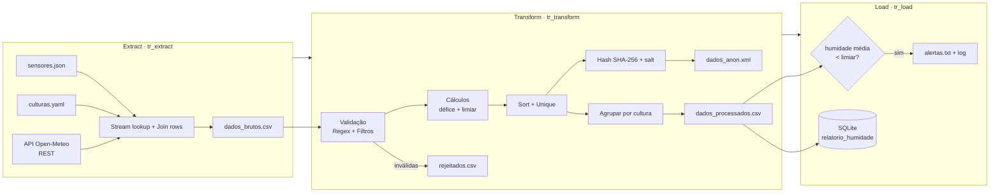

# Pipeline ETL de Agricultura de Precisão

Trabalho Prático I — **Integração de Sistemas de Informação (ISI)** · Licenciatura em Engenharia de Sistemas Informáticos · 2026/27

| | |
|---|---|
| **Aluno** | Diogo — nº `29339` |
| **Ferramenta** | Pentaho Data Integration (Kettle) 10.2 |
| **Relatório** | [`doc/29339_doc.pdf`](doc/) |
| **Vídeo de demonstração** | `https://drive.google.com/file/d/1wr-2wHoVuEphqnKi2UwvQj_g_BjHxob_/view?usp=sharing` |

---

## 1. Problema

Uma exploração agrícola tem sensores de humidade do solo espalhados por três tipos de cultura (milho, vinha e olival). Cada cultura tem um intervalo de humidade ideal, e a necessidade de rega depende também do tempo (calor e vento aceleram a secagem do solo).

Este projeto implementa um pipeline **ETL** que:

1. recolhe as leituras dos sensores, as regras de cada cultura e o tempo atual;
2. valida e limpa os dados (formato do ID, timestamp, culturas desconhecidas, valores nulos, duplicados);
3. calcula a humidade média por cultura e compara-a com um **limiar de alerta dinâmico**;
4. guarda os resultados numa base de dados, gera alertas de rega e avisa por e-mail;
5. exporta uma versão **anonimizada** das leituras para um destinatário externo.

## 2. Arquitetura



### Orquestração — `jr_program.kjb`

```
Start → Set variables (SALT) → Simple evaluation (SALT válido?)
      → tr_extract → tr_transform → tr_load → Mail (sucesso + alertas.txt)
```

- Cada transformação só avança em caso de **sucesso**.
- Se uma transformação falha, é enviado um **e-mail específico** (extração / transformação / carregamento) e o Job termina com *Abort*.
- Se o `SALT` estiver em falta ou por substituir, o Job aborta antes de processar dados.
- O log do Job é escrito em `dataintegration/logs/job_log.log`.

## 3. Fontes, formatos e operações

| Fase | Fontes / destinos | Formatos |
|---|---|---|
| **Extract** | `sensores.json`, `culturas.yaml`, API REST Open-Meteo (coordenadas 41.53, -8.62) | JSON, YAML, JSON (REST) |
| **Transform** | `dados_brutos.csv` | CSV |
| **Load** | `agricola.db` (SQLite), `dados_processados.csv`, `alertas.txt`, `rejeitados.csv`, `dados_anon.xml` | SQL, CSV, TXT, XML |

**Operações de transformação usadas:**

- **Expressões regulares:** ID do sensor (`^SEN-\d{3}$`) e timestamp ISO-8601 UTC com intervalos válidos (mês, dia, hora, minuto, segundo).
- **Limpeza e validação:** deteção de culturas desconhecidas (`ERR_*`), humidade nula e timestamps inválidos; as linhas rejeitadas vão para `rejeitados.csv` com a coluna `motivo`.
- **Duplicados:** *Sort rows* + *Unique rows* com chave `sensor_id + timestamp`.
- **Cruzamento de dados:** *Stream lookup* (leituras × regras da cultura) e *Join rows* (leituras × tempo atual).
- **Cálculos:** défice de humidade (`humidade_minima − humidade`) e limiar de alerta dinâmico:
  `limiar_alerta = humidade_minima + 5 (se temperatura_ar > 30) + 3 (se velocidade_vento > 20)`.
- **Agregação:** humidade média por cultura e limiar.
- **Anonimização:** hash SHA-256 de `sensor_id` + `SALT` (irreversível), num ramo separado para destinatários externos.
- **Conversão de formato:** JSON/YAML/CSV → CSV → XML e SQL.
- **Notificação:** e-mails de falha e de sucesso (com `alertas.txt` em anexo).

## 4. Estrutura do repositório

```
.
├── README.md
├── doc/
│   └── <NÚMERO DE ALUNO>_doc.pdf    # relatório final
├── dataintegration/
│   ├── jr_program.kjb               # Job de orquestração
│   ├── tr_extract.ktr
│   ├── tr_transform.ktr
│   ├── tr_load.ktr
│   └── logs/job_log.log
├── data/
│   ├── input/
│   │   ├── sensores.json
│   │   └── culturas.yaml
│   └── output/                      # exemplos de saída
│       ├── dados_brutos.csv
│       ├── dados_processados.csv
│       ├── alertas.txt
│       ├── rejeitados.csv
│       ├── dados_anon.xml
│       └── agricola.db
└── src/                             # código fonte desenvolvido
```

Todos os caminhos nas transformações e no Job são **relativos** (`${Internal.Entry.Current.Directory}/../data/...`), por isso o projeto funciona em qualquer máquina sem alterações.

## 5. Como executar

### Requisitos

- [Pentaho Data Integration](https://pentaho.com/) 10.2 (Spoon / Kitchen) e Java compatível
- Driver JDBC do SQLite disponível no PDI
- Acesso à internet (API Open-Meteo)
- Um servidor SMTP de teste em `localhost:25` — por exemplo o [smtp4dev](https://github.com/rnwood/smtp4dev) — para receber os e-mails

### Passos

1. Clonar o repositório:
   ```bash
   git clone https://github.com/Diogo193/ETL_agriculture.git
   cd ETL_agriculture
   ```
2. Garantir que a tabela de destino existe em `data/output/agricola.db`:
   ```sql
   CREATE TABLE IF NOT EXISTS relatorio_humidade (
       cultura        TEXT,
       limiar_alerta  REAL,
       media_humidade REAL
   );
   ```
3. Abrir `dataintegration/jr_program.kjb` no Spoon e executar, **ou** correr na linha de comandos:
   ```bash
   kitchen.sh -file=dataintegration/jr_program.kjb -level=Basic
   # Windows: Kitchen.bat /file:dataintegration\jr_program.kjb /level:Basic
   ```
4. Verificar os resultados em `data/output/` e o log em `dataintegration/logs/job_log.log`.

### Configuração

| Item | Onde | Nota |
|---|---|---|
| `SALT` | entrada *Set variables* do Job | Usado no hash de anonimização. Com `SALT` vazio todos os sensores teriam o mesmo hash, por isso o Job aborta se não estiver definido. **Em produção, não deve ficar no repositório.** |
| Servidor e destinatário de e-mail | entradas *Mail* do Job | Por omissão `localhost:25` e `agricultor@teste.local` |
| Coordenadas do tempo | passo *REST client* do `tr_extract` | URL da API Open-Meteo |

## 6. Exemplo de resultado

Com os dados de exemplo (11 leituras: 1 duplicada e 3 rejeitadas por cultura desconhecida ou timestamp inválido):

| cultura | limiar_alerta | media_humidade | alerta |
|---|---|---|---|
| MILHO | 60 | 53.3 | **sim** (53.3 < 60) |
| VINHA | 40 | 46.5 | não |
| OLIVAL | 30 | 39 | não |

## 7. Limitações e trabalho futuro

- A temperatura do ar e a velocidade do vento vêm de **uma única chamada à API** e aplicam-se a todas as leituras; o ideal seria um valor por localização/parcela.
- Os ficheiros de entrada são estáticos; uma fonte em *streaming* (Node-RED, MQTT/Mosquitto) permitiria leituras contínuas e um dashboard em tempo real.
- Exportação para servidor remoto (FTP/SFTP) e uma base de dados como origem de dados.
- No `dados_anon.xml` os números aparecem com vírgula decimal; convém uniformizar com o formato do restante pipeline.
- Gerir o `SALT` fora do repositório (variável de ambiente ou ficheiro de propriedades).

## 8. Referências

- Enunciado TP1 — ISI 2026/27 (Luís Ferreira & Óscar Ribeiro)
- Documentação Pentaho Data Integration — <https://docs.hitachivantara.com/r/en-us/pentaho-data-integration>
- API Open-Meteo — <https://open-meteo.com/en/docs>
- smtp4dev — <https://github.com/rnwood/smtp4dev>
